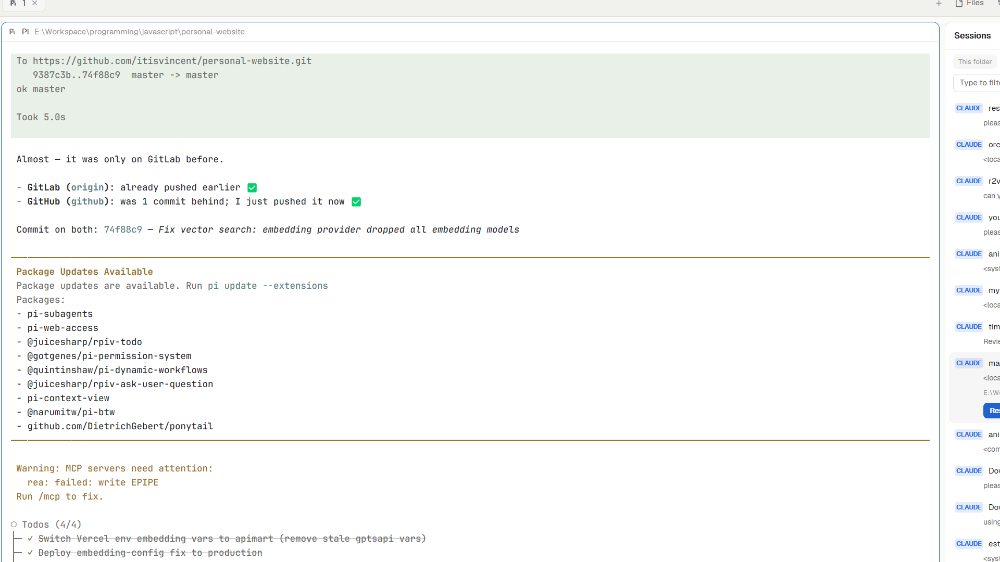

# Session history



An Orca-style **Agent Session History** for the Herdr app: a **Sessions** tab in the window's right panel (alongside Files and Changes) that lists past Pi, Claude and Codex sessions from disk and resumes the one you pick into a real Herdr space/tab. Includes Reveal (locate the transcript in Explorer) and Delete with confirm.


## What you see

1. Tab bar: **Files · Changes · 🕐 Sessions** (from the included `space-tabs` clone; the shipped `tabs` mod is not modified).
2. The right panel shows one of them, like Herdr's stock Files/Changes panels: same card look, 42px header with the panel name.
3. Sessions tab: **This folder / All** scope chips, **Pi / Claude / Codex** agent chips, a filter field, then sessions newest-first: agent chip, folder label, age, one-line preview.
4. Click a row to expand: full cwd, **Resume**, **Copy cmd**, **Reveal**, **Delete** (two-step: "Delete?" → "Keep it").

## How it behaves

- **Scan**: `mods/session-history/scan.ps1` walks (newest first, head-read only, so 3 GB of transcripts still scan fast):
  - Pi: `~/.pi/agent/sessions/**/*.jsonl`
  - Claude: `~/.claude/projects/**/*.jsonl` and ReClaude `~/.rec/claude/accounts/*/config/projects/**/*.jsonl` (skips `subagents`)
  - Codex: `~/.codex/sessions/**/*.{jsonl,json}`
- **Filtering is client-side (instant)** — no rescan when you click:
  - *This folder*: a session belongs to the active space when its `cwd` matches the space's folder **or any of that space's live terminals' cwds** (prefix-aware); no more sessions "leaking" because a space recorded a parent folder.
  - Agent chips toggle Pi/Claude/Codex; the text field filters agent/folder/cwd/preview/id.
- **Resume** works like the + menu:
  - a session's cwd matches an existing space (exact folder) → `tab.new` there, then select the space;
  - otherwise → `space.new { folder, argv }` (real space + tab + agent).
  - argv per agent: `pi --session <file>`, `claude --resume <id>`, `codex resume <id>`.
- **Reveal** → Windows `explorer.exe /select,"<file>"`; macOS `open -R <file>`; Linux `xdg-open <folder>`. **Delete** → arm/click-again, removes the transcript (`Remove-Item` on Windows, `rm -f -- <file>` elsewhere), then rescan. **Copy cmd** → `Set-Clipboard` on Windows, `pbcopy` on macOS, `wl-copy` or `xclip -selection clipboard` on Linux; the command goes in as an argument, never into a command line.
- The scan repeats every 15 s; one PowerShell (Windows) or `scan.sh` (macOS, Linux; needs `python3`) process per scan.

## Built from

1. `mods/session-history/` — `main.js`, `mod.json` (`place: "none"`), `scan.ps1` (Windows PowerShell), `scan.sh` (macOS, Linux), `icon.svg`.
2. `mods/space-tabs/` — bundled clone of the shipped `tabs` mod with a third panel button. It differs from stock tabs in one way: a space switch never hides the panel (it only jumps to a panel tab the space explicitly chose before), so a Resume that lands in another space doesn't slam the panel shut.
3. Layout (a clone of `main`, not the shipped one) where:

```json
{
  "id": "panel",
  "type": "column",
  "hidden": false,
  "size": { "px": 380 }, "min": 280, "max": 560,
  "children": [{
    "id": "panel-body", "type": "stack", "active": "sessions",
    "children": [
      { "id": "files",   "type": "block", "content": { "mod": "files" } },
      { "id": "changes", "type": "block", "content": { "mod": "changes" } },
      { "id": "sessions","type": "block", "content": { "mod": "session-history" } }
    ]
  }]
}
```

and the tab bar block's content is `{ "mod": "space-tabs" }`.

- Keys: `"ctrl-alt-s": "layout.toggle:panel"` (a panel toggle; the Sessions button is unconditional in `space-tabs`, so no shared key can hide it).
- Herdr APIs: `spaces`, `panes`, `run("tab.new"|"space.new"|"space.select"|"layout.*")`, `exec`, `appHome`, `home`, `shared`/`setShared`, `theme`, `Input`/`InputState`.

## Watch out

- **panel-body slot identity matters**: the sessions block must live inside the `panel-body` stack. A separate sibling column in `work-body` breaks divider drags (the boundary resizes the files/agents side, never the sessions panel).
- The stack child must have a **fresh `id`** (e.g. `sessions`) distinct from `files`/`changes`; changing a block's `content.mod` under an id Herdr already loaded kept rendering the old mod.
- Peek/floating drawers render differently from layout blocks here; this mod ships as a normal panel.
- Peek drawers must keep one fixed layout; this panel avoids that constraint entirely.
- Mods are trusted code: this one runs PowerShell (Windows) or `sh` (macOS, Linux) and reads (and can delete) session transcripts under your home.

## Done when

1. `herdr-app check` passes for both mod folders.
2. The tab bar shows `Files · Changes · Sessions`; clicking Sessions opens the shared panel.
3. `This folder` only lists sessions belonging to the active space (per-terminal cwds included); `All` lists everything; typing filters instantly.
4. Resume opens a tab in the exact-match space or creates a new space in the sidebar.
5. Reveal shows the transcript in Explorer or Finder, or opens its folder on Linux; Delete (armed) removes it and the list rescan drops the row; Copy cmd puts the resume command on the clipboard.